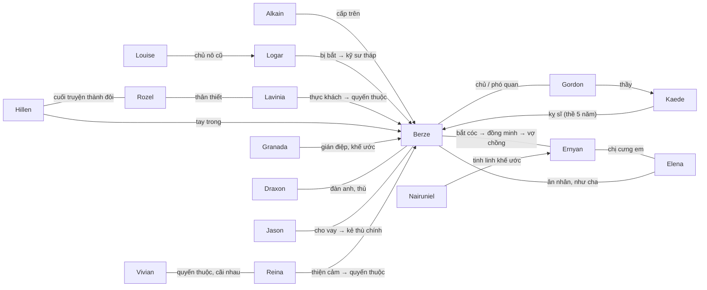

# Ngữ cảnh, quan hệ & xưng hô — *마왕인데 용사가 너무 많음*

> Tài liệu nghiên cứu cho `book_id: the-demon-king-overrun`. **Không chứa nguyên văn chương.** Mọi đề xuất xưng hô ở đây là **ứng viên** (`relationship_review_queue` trong `canon.json`), chưa `locked`, phải đối chiếu cảnh gốc trước khi khóa (PROTOCOL §1–2).
> Cập nhật: 2026-10-23.

## 0. Tên gọi & nguồn
| | |
|---|---|
| Nguyên tác (KR) | 마왕인데 용사가 너무 많음 — web novel Munpia, đã hoàn (≈269 chương chính + ngoại truyện) |
| Tên tiếng Anh | The Demon King Overrun by Heroes |
| Tên tiếng Việt (manhwa & novel dịch) | **Sự Chuẩn Mực Của Ma Vương** |
| Manhwa VN | nhóm Bách Diệp Comics, tới chap 52 (16/10/2026) — truyenqq, zettruyen, baotangtruyen |
| Novel VN | ln.hako.vn/ai-dich/26105 — **bản dịch AI**, bình luận độc giả chê nhiều lỗi (lẫn "chiến binh/anh hùng") → chỉ tham khảo tên, không dùng làm chuẩn |

Nguồn: [namu.wiki](https://namu.wiki/w/마왕인데%20용사가%20너무%20많음) (mục 6–7), [namu.wiki – webtoon](https://namu.wiki/w/마왕인데%20용사가%20너무%20많음(웹툰)), [hako](https://ln.hako.vn/ai-dich/26105-su-chuan-muc-cua-ma-vuong), [truyenqq](https://www.truyenqq.ca/truyen-tranh/su-chuan-muc-cua-ma-vuong), [zettruyen](https://www.zettruyen3.com/truyen-tranh/su-chuan-muc-cua-ma-vuong).

⚠️ Theo hako và namu, **manhwa lệch novel khá nhiều** (vd. 아이나 → 나이아 디아프린 trong webtoon; Daphne chết sớm hơn). Không lấy diễn biến manhwa làm căn cứ cho novel.

## 1. Bối cảnh
- **Arein (아레인)**: chiều không gian nguy hiểm nhất, nơi ~4.732 dũng giả (용사) tồn tại; bị điều tới Arein gần như án tử với Ma Vương. Dũng giả ở đây giống mạo hiểm giả hám tiền hơn anh hùng.
- **Cấp bậc ma giới**: Ma Vương (마왕, thực chất là tiên phong) < Đại công (대공) < Ma Hoàng (마황).
- **Chuẩn mực Ma Vương (마왕의 정석)**: cẩm nang của Ma Hoàng đời đầu; trọng tâm là bắt cóc hoàng tộc. Ma Vương thề "nhân danh Chuẩn mực" là tuyệt đối — Berze lợi dụng để lừa. (Spoiler: mục đích thật là làm chết nhiều ma tộc.)
- **Tháp (탑)**: mọc từ hạt giống + máu Ma Vương. Tháp của Berze = **Tháp Nghiệp Hỏa (업화의 탑)**, đặt ở **dãy Erzest (에르제스트)**, sau gắn chân thành tháp di động, rồi Thiên Không Tháp. Ma khí điểm (마기 포인트) nạp từ con tin hoàng tộc.
- **Cốt truyện**: Berze theo đúng Chuẩn mực, bị dũng giả giết → **hồi quy** về lễ tốt nghiệp, tuyên bố Chuẩn mực là rác, bị tước ưu đãi, chỉ mang Gordon. Định bắt công chúa thứ 13 nhưng bắt nhầm **đệ nhất công chúa Ernyan** — người lại tự nguyện ở lại. Từ đó Berze "chiêu mộ" các công chúa làm **Tứ Thiên Vương (사천왕)**.
- **Tứ Thiên Vương**: Thuật sĩ tinh linh bóng tối (Ernyan) · Hắc ám kỵ sĩ (Kaede) · Quân đoàn trưởng tử thần (Lavinia) · Người khổng lồ địa ngục (Louise; Ernyan đùa thành "người tí hon địa ngục"). Người ngoài tưởng là ma tộc cấp cao.
- **Thuật ngữ đề xuất**: 용사 = **dũng giả** (thống nhất, không dùng "chiến binh"); 10성 용사 = Thập Tinh dũng giả; 권속 = quyến thuộc; 정령왕 = Tinh linh vương; 용사행 = cuộc chinh phạt (của dũng giả). Đều chưa khóa.

## 2. Nhân vật
Phiên âm Latin: chỉ Berze, Gordon, Hillen Cargill, Vivian Blunt, Reina Sordein, Louise Verft, Lavinia Akan, Kaede Jespine, Logar/Logger, Nairuniel đã thấy trong bản EN/VN; **các họ còn lại là phiên âm tạm của tài liệu này**.

| ID | Hàn | Latin | Tên trong bản VN | Vai trò |
|---|---|---|---|---|
| berze | 베르제 데이아스 | Berze Deias | Berze | Nhân vật chính, Ma Long tộc hắc viêm, hồi quy |
| gordon | 고든 다이리크 | Gordon Dairik* | Gordon | Phó quan/thư ký |
| alkain | 알카인 블라미프 | Alkain Blamif* | ? | Đại công, cấp trên |
| ernyan | 에르냔 힐데란 | Ernyan Hilderan | **Ernian** | Đệ nhất công chúa, nữ chính |
| elena | 엘레나 힐데란 | Elena Hilderan | ? | Công chúa 13, em gái Ernyan |
| kaede | 카에데 제스파인 | Kaede Jespine | Kaede Jespine | Hoàng nữ 9 Jespine, kỵ sĩ của Berze |
| louise | 루이제 베르프트 | Louise Verft | Louise Verft | Công chúa người lùn |
| lavinia | 라비니아 아칸 | Lavinia Akan | Lavinia | Công chúa 3 Akan, nhà chimera học |
| logar | 로거 프리드리 | Logar/Logger | **Roger** (hako, không thống nhất) | Thợ rèn người lùn |
| granada | 그라나다 | Granada | ? | Elf nô lệ → gián điệp |
| hillen | 힐런 카길 | Hillen Cargill | Hillen / Hillan | Dũng giả Hilderan, tay trong |
| rozel | 로젤 차른트 | Rozel Charnt* | ? | Đại pháp sư lửa Akan |
| jason | 제이슨 코크문도 | Jason Cokmundo* | Jason (ch.31 ghi "Jetson") | Ma Vương lâu năm nhất; phản diện |
| draxon | 드락슨 돌도프 | Draxon Doldorf* | ? | Tháp Dã Thú, đàn anh |
| reina | 레이나 소르데인 | Reina Sordein | Reina Sordein | Tháp Băng Giá |
| vivian | 비비안 블런트 | Vivian Blunt | Vivian | Succubus, Ma Vương mới |
| ugar | 우가르 벨베크 | Ugar Belbek* | Ugar | Tháp Kim Cương, titan |
| doroche | 도르체 아스트인 | Dorche Astin* | ? | Ma Long tộc, Ma Vương mới (chưa vào canon) |
| valaf | 발라프 디스로드 | Valaf Disrod* | ? | Dũng giả mạnh nhất |
| nairuniel | 나이루니엘 | Nairuniel | Nairuniel | Tinh linh nước của Ernyan |
\* = phiên âm tạm.

## 3. Sơ đồ quan hệ

### Giai đoạn đổi quan hệ (mốc theo namu/hako, số chương novel là ước lượng từ tiêu đề hako)
1. **Ernyan–Berze**: con tin (ch.5–6) → đồng phạm tự nguyện, tự xưng Tứ Thiên Vương → bị trả về Hilderan khi tháp lộ vị trí → hậu kỳ: mọi người coi là tình nhân "trừ hai người họ" → cưới, Ma Hoàng phi (kết, ch.~269).
2. **Kaede–Berze**: kẻ địch/con tin → thề trung thành 5 năm, thành kỵ sĩ (cần xác định chương).
3. **Hillen–Berze**: kẻ địch (ch.~24) → bị khống chế, tay trong bất đắc dĩ → giữa truyện "all-in" theo Berze.
4. **Thập Tinh dũng giả**: kẻ địch → lần lượt thành quyến thuộc.

## 4. Ma trận xưng hô (đề xuất)
Ký hiệu tín hiệu Hàn: **반말** (nói trống/ngang-dưới), **존댓말** (kính ngữ), **-님** (kính xưng), 언니/선배/스승님/주군.
Trạng thái: ✅ có chứng cứ gián tiếp · ❓ suy từ vai trò, **cần cảnh gốc**.

| Người nói → người nghe | Giai đoạn | Tín hiệu Hàn (dự kiến) | Xưng / gọi VN đề xuất | TT | Ghi chú |
|---|---|---|---|---|---|
| Berze → hầu hết mọi người | mọi giai đoạn | 반말, giọng Ma Long kiêu ngạo | **ta / ngươi** | ✅ | Tiêu đề VN ch.17 "Ngươi điên rồi à?", ch.20 "Ta có thể tin ngươi không?" |
| Berze → Ernyan, công chúa | con tin | 반말 | **ta / cô** (công chúa) | ✅ | Ch.27 VN "Tại sao cô lại làm thế với ta?"; "ngươi" cũng có thể khi bực — chốt một |
| Berze → Ernyan | vợ chồng | ? | ta / nàng hoặc anh / em | ❓ | Không đổi sớm hơn mốc cưới |
| Gordon → Berze | mọi giai đoạn | 존댓말 + 마왕님 | **thuộc hạ/tôi / Ma Vương đại nhân (ngài)** | ❓ | Có thể thành "bệ hạ" sau khi Berze làm Ma Hoàng |
| Berze → Gordon | | 반말 | ta / ngươi | ❓ | |
| Ernyan → Berze | con tin–đồng minh | lịch sự–trêu chọc (cần xác định 존댓말 hay 반말) | **tôi / ngài** (hoặc "Ma Vương") | ❓ | Giữ sắc thái mỉa mai; quyết định sau khi đọc ch.5–10 |
| Ernyan → Berze | vợ chồng | ? | em / anh hoặc thiếp / chàng | ❓ | |
| Elena → Ernyan | | 언니 | **em / chị** | ✅ | quan hệ chị em ruột (namu) |
| Ernyan → Elena | | 반말 | **chị / em** | ✅ | |
| Elena → Berze | | 존댓말 | em (cháu) / ngài | ❓ | Elena coi Berze như cha — không dùng "anh" |
| Kaede → Berze | kỵ sĩ | 존댓말, có thể 주군 | **thần/tôi / chúa công** | ❓ | Tiêu đề VN ch.148 "Hiệp sĩ của tôi" |
| Kaede → Gordon | đệ tử | 스승님? | con / sư phụ (hoặc em / thầy) | ❓ | |
| Berze → Draxon | gặp đầu | 반말 với 선배 = bất kính | ta / ngươi | ❓ | Nên dịch để thấy Berze láo với đàn anh |
| Draxon → Berze | | coi là 후배 | ta / ngươi (thằng nhãi) | ❓ | |
| Jason → Berze | cho vay | thân thiện giả tạo | ta / cậu hoặc ta / ngươi | ❓ | Giọng "đàn anh tốt bụng" |
| Granada → Berze | khế ước | 존댓말 | tôi / ngài | ❓ | |
| Logar → Berze | | ? | tôi / ngài (ma vương) | ❓ | |
| Lavinia → bất kỳ ai | | câu cực ngắn | lược đại từ; nếu cần: tôi / anh | ❓ | Giữ câu cụt (namu) |
| Hillen → công chúng | | lịch thiệp giả tạo | tôi / quý vị | ❓ | Hai mặt: riêng tư thô hơn |
| Rozel → Hillen | trước ch.~50 | khinh | tôi / anh ta, ngươi | ❓ | Đổi khi thành đôi (cuối truyện) |
| Reina ↔ Vivian | quyến thuộc | cãi nhau | ta / ngươi hoặc tôi / cô | ❓ | |
| Nairuniel → Ernyan | | ? | ta? / công chúa | ❓ | |

### Quy tắc chung đề xuất
- Ma tộc nói với nhau: **ta / ngươi**; hoàng tộc nói với cấp dưới: ta / ngươi; dũng giả với nhau: tôi / anh, cô, cậu tùy tuổi.
- Narration: 3rd person — Berze = "hắn/Berze", Ernyan = "nàng" hoặc "cô" (chọn 1, khóa).
- Không đổi xưng hô theo cảm tính; chỉ đổi tại các mốc ở §3.

## 5. Khoảng trống cần xác minh
1. Không đọc được thoại manhwa VN (truyện ảnh) → chưa xác nhận Bách Diệp Comics dùng gì cho Ernyan→Berze, Gordon→Berze.
2. Chưa có cảnh gốc Hàn để xác định 존댓말/반말 từng cặp (chưa có quyền nguồn — PROTOCOL §0).
3. Romanization họ có dấu * là tạm; tên Logar (EN: Logger, VN: Roger) cần chọn một.
4. Số chương cho mốc Kaede thề trung thành, Ernyan bị trả về Hilderan, Hillen "all-in" chưa xác định.
